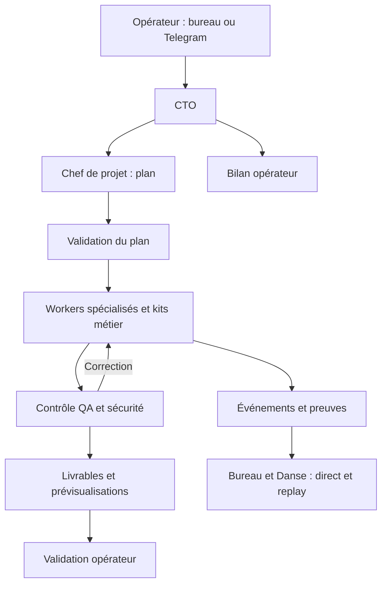

# Architecture

Les données métier résident dans des stockages privés absents de ce dépôt. Le viewer consulte une projection filtrée en lecture seule, avec contrôle d'accès. Les transports à privilèges et les fournisseurs sont isolés des workers. Les clés d'idempotence, les états de reprise et les preuves permettent de distinguer une action confirmée d'un effet incertain.

Les dossiers `experimental` contiennent des développements qui ne constituent pas une preuve de disponibilité en production. Les commandes d'exploitation et les anciens observateurs sont publiés pour conserver le projet complet, sans affirmer qu'ils doivent tous être activés ensemble.
